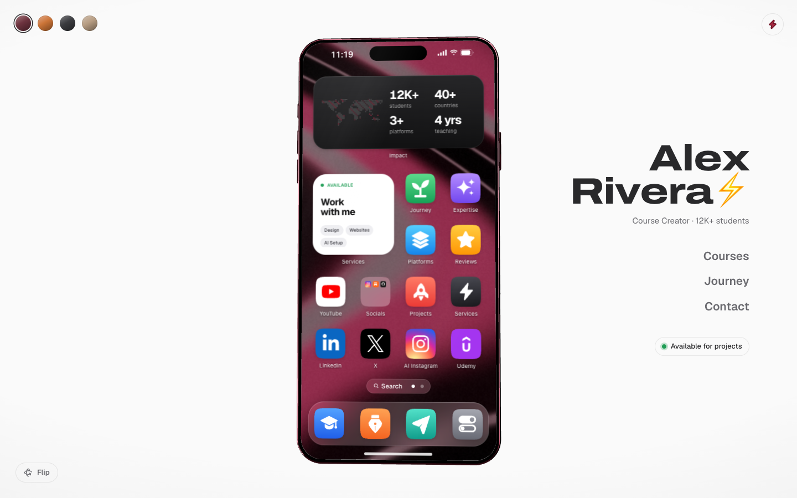
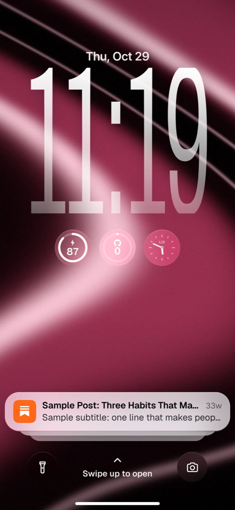
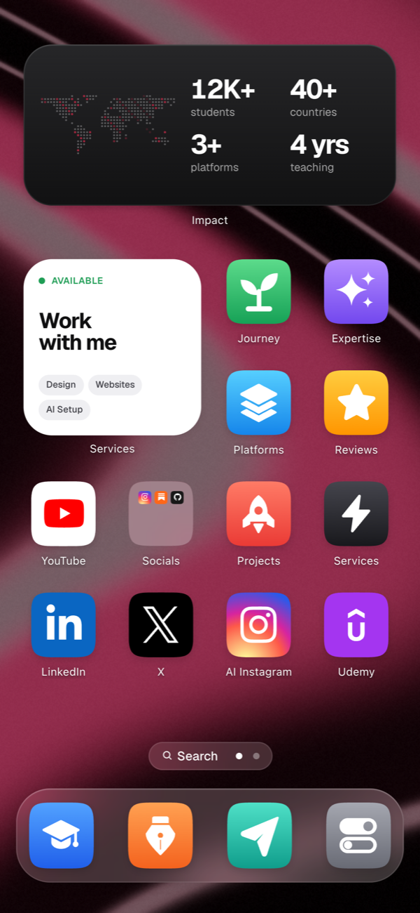
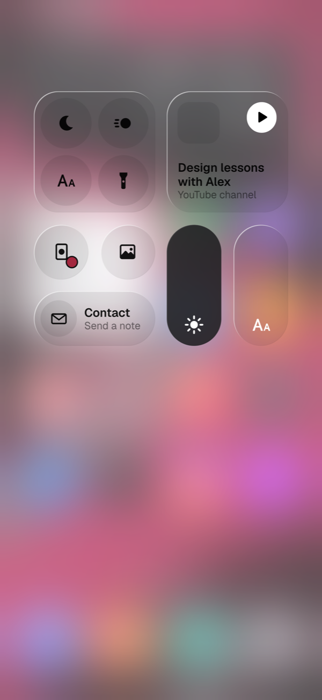
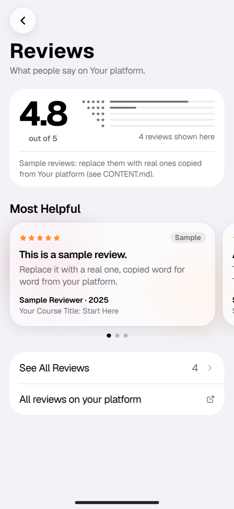
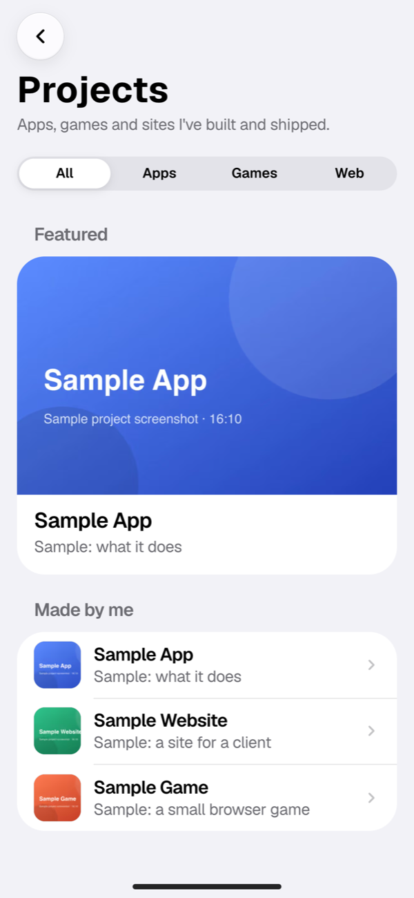

# Pocket Portfolio (template)

A personal website that works like a phone: 3D phone, lock screen, home screen, apps.

On a desktop, a 3D phone sits in a calm studio: drag beside it to turn it over, and use its screen
like a real phone. Below 600 px wide the site *is* the phone, and it installs to a home screen as
an app. Every section of your portfolio is an app. Everything you see is sample content for a
made-up person, "Alex Rivera": change it in `content/*.ts` and it's yours.

**New here? Read [START-HERE.md](START-HERE.md).**

[](https://vercel.com/new/clone?repository-url=https%3A%2F%2Fgithub.com%2Fchetanpujari5105%2Fpocket-portfolio-template&project-name=pocket-portfolio&repository-name=pocket-portfolio&env=NEXT_PUBLIC_ICON_PACK,NEXT_PUBLIC_ENABLE_ASK&envDefaults=%7B%22NEXT_PUBLIC_ICON_PACK%22%3A%22original%22%2C%22NEXT_PUBLIC_ENABLE_ASK%22%3A%22false%22%7D&envDescription=Pre-filled%3A%20keep%20these%20as%20they%20are.%20Email%20for%20the%20contact%20form%20%28GMAIL_USER%2C%20GMAIL_APP_PASSWORD%2C%20CONTACT_TO_EMAIL%29%2C%20GITHUB_TOKEN%20and%20the%20rest%20are%20optional%3A%20add%20them%20later%20under%20Settings%20%3E%20Environment%20Variables.&envLink=https%3A%2F%2Fgithub.com%2Fchetanpujari5105%2Fpocket-portfolio-template%23environment-variables)

| Desktop (3D phone) | Phone: lock screen | Phone: home screen |
| --- | --- | --- |
|  |  |  |

| Control Center | Reviews | Projects |
| --- | --- | --- |
|  |  |  |

## What's inside

- **3D phone.** An original phone drawn in code with React Three Fiber (no model file). Drag to
  turn it, flip it to see your initials on the back, pick one of four finishes. Falls back to a
  CSS phone on tablets, without WebGL and with reduced motion.
- **Lock screen.** A tall clock fitted to the screen, three round widgets (battery, your GitHub
  week, a clock in your city), flashlight and camera buttons, and a notification stack made of your
  own content: your newest blog post, your newest reel and one project. Swipe up to unlock.
- **Home screen.** Two pages: apps, a "Work with me" widget and an impact counter on page 1, a
  GitHub heatmap, your latest blog post, a YouTube widget and an Expertise Smart Stack on page 2. A dock with Settings, a
  Socials folder, a brand row with room for a second Instagram account. Visitors can long-press to
  move apps, make folders and edit the dock (saved in their browser).
- **Control Center.** Pull down from the top-right corner (or tap the battery): dark mode, reduce motion, larger text,
  flashlight, brightness, finish and wallpaper, your latest video and a shortcut to Contact.
- **Apps**, laid out like iOS Settings with shared grouped rows (`src/components/ui/grouped.tsx`):
  - **Reviews**: a ratings summary, a paged carousel and All Reviews with course filters.
  - **Journey**: your milestones on a timeline, each with its own detail screen, and your story.
  - **Services** and **Platforms**: what you offer and where people find you, with details.
  - **Courses**: a featured course, categories and an Enroll button per course.
  - **Blog**: your Substack (or any RSS) feed, with fallback posts.
  - **Expertise**: skill areas linked to your courses and services.
  - **Projects**: a segmented filter, a featured card, status, stack and link for each.
  - **Contact**: a form that emails you through Gmail (or Resend), with a mailto fallback.
  - **Settings**: appearance, wallpaper, finish, home screen, accessibility and your profile.
- **Reliable data.** The GitHub heatmap comes from a cached `/api/contributions` route, with a
  committed snapshot when GitHub can't be reached. The YouTube widget keeps the last good video
  when the channel feed fails.
- **Fits every phone and is fast.** Tested at 17 screen sizes; every app's code is on the device
  before the first tap; a service worker makes repeat visits load almost at once.
- **System look.** Sizes, spacing and system colours live in one place, `src/lib/ios-tokens.ts` and
  the `--ios-*` variables in `src/app/globals.css`, so light and dark mode and Larger Text work everywhere.

Built with Next.js 16 (App Router, Cache Components), React 19, Tailwind CSS v4, Motion, Zustand,
Zod and React Three Fiber.

## Make it yours

1. **Content.** Every field to change is marked `// ✏️ EDIT:` in `content/*.ts`.
   [CONTENT.md](CONTENT.md) explains each one.
2. **Images.** Replace the samples in `public/content/` (sizes in [START-HERE.md](START-HERE.md)).
3. **Reviews.** The template ships 4 reviews marked "Sample". Replace them with real reviews copied
   word for word from your own platform (CONTENT.md → Reviews).
4. **With Claude Code.** The prompts in [`prompts/`](prompts/) do the work for you:
   [`02-personalize.md`](prompts/02-personalize.md) fills in everything from a worksheet;
   [`11-apple-style-polish.md`](prompts/11-apple-style-polish.md) and
   [`12-real-reviews.md`](prompts/12-real-reviews.md) come after.

## Run locally

Requires Node.js 20.9+ (tested on Node 24) and Git.

```bash
npm ci
cp .env.example .env.local   # optional: fill in what you need (see below)
npm run dev                  # http://localhost:3000
```

Production build:

```bash
npm run build && npm run start   # add `-- -p 3100` for another port
```

## Test

```bash
npm run lint          # ESLint
npm run typecheck     # TypeScript
npm run content:check # validate content/*.ts against the schemas
npx playwright install chromium   # once
npm test              # Playwright: builds and serves on :3100, then runs every check
```

`npm test` covers every app, the lock screen, Control Center, the home screen and its editing, the
17-size fit check (`tests/fit.spec.ts`, sizes in `tests/devices.json`), the contact form against a
fake Gmail and Resend (never the real ones), visual snapshots and, last and on their own, launch
timings on a phone slowed to 4× (`tests/speed.spec.ts`).

After you change content or design, the visual snapshots no longer match. Update them once, on
purpose, and look at what changed:

```bash
npx playwright test tests/visual.spec.ts --update-snapshots=changed
```

`npm test` reuses a server already running on port 3100. If another app holds that port, run
`PORT=3200 npm test`.

Extra scripts (run against a server on :3100): `node scripts/check-os.mjs <outDir>` (a
click-through), `node scripts/a11y.mjs` (axe and keyboard checks), `node scripts/fit-shots.mjs`
(screenshots at all 17 sizes), `node scripts/shell-shots.mjs <outDir>` (every app, light and dark),
`node scripts/label-contrast.mjs` (home labels over the wallpaper), `node scripts/speed-moments.mjs`.

Before every `npm run build`, `prebuild` regenerates the blurred image previews, writes the service
worker (`public/sw.js`, from `sw/sw.ts`; it has to exist before `next build` because Vercel
collects `public/` during the build) and, on Vercel only, refreshes the YouTube snapshot.

## Deploy

**One click:** the **Deploy with Vercel** button above copies this repo to your GitHub account and
deploys it. It shows two variables already filled in (`NEXT_PUBLIC_ICON_PACK=original`,
`NEXT_PUBLIC_ENABLE_ASK=false`): keep them. Everything else (the contact form's Gmail settings,
`GITHUB_TOKEN`, …) is optional; add it afterwards under *Settings → Environment Variables* and redeploy.

**By hand:** push this project to your own GitHub repo, then import it at
[vercel.com/new](https://vercel.com/new). Next.js is detected; keep the default build settings.
Add variables under *Project → Settings → Environment Variables*, then **Deploy**.

### No domain needed

Vercel gives every project a free address like `your-project.vercel.app`, and the site uses it
automatically for its links, sitemap and share images (`VERCEL_PROJECT_PRODUCTION_URL`). The contact
form sends from your own Gmail, so you don't need a domain for email either. When you do buy a
domain, add it under *Settings → Domains* and set `NEXT_PUBLIC_SITE_URL` to it.

## Environment variables

All optional: the site works without any of them. `NEXT_PUBLIC_*` values are baked in at build
time, so redeploy after changing them. Never commit real values; `.env.local` is git-ignored.

| Variable | Used for | Without it |
| --- | --- | --- |
| `GMAIL_USER` | Contact form: the Gmail address that sends the messages (server only) | Form offers "email me directly" |
| `GMAIL_APP_PASSWORD` | Contact form: a Google app password for that address, 16 letters (server only) | Same |
| `CONTACT_TO_EMAIL` | Where contact messages go | `email` in `content/profile.ts` |
| `RESEND_API_KEY` | Contact form fallback through [Resend](https://resend.com), used only when neither Gmail variable is set (server only) | Not used |
| `CONTACT_FROM_EMAIL` | Resend sender on a verified domain, e.g. `Your Name <hello@yourdomain.com>` | `onboarding@resend.dev`, which only delivers to your own Resend account email |
| `GITHUB_TOKEN` | GitHub heatmap through the GraphQL API; a fine-grained token with no permissions is enough (server only) | Reads the public contributions page, then the committed snapshot |
| `NEXT_PUBLIC_ENABLE_ASK` | `true` shows the optional Ask app | Hidden |
| `OPENAI_API_KEY` | Ask app answers (server only) | Ask shows "email me directly" |
| `NEXT_PUBLIC_ICON_PACK` | `ios18` uses an icon pack you add yourself (see below) | `original`: the template's own icons |
| `NEXT_PUBLIC_SITE_URL` | Your canonical address, for SEO, the sitemap and share images | Vercel's production address, then `site.url` in `content/profile.ts` |

`OPENAI_MODEL` (default `gpt-5-mini`) picks the Ask app's model.

### Contact form email: a Gmail app password

The form sends one email per message from your Gmail account to you, with the visitor as Reply-To.

1. Turn on 2-Step Verification for your Google account: [myaccount.google.com/security](https://myaccount.google.com/security).
   App passwords only exist with it on.
2. Open [myaccount.google.com/apppasswords](https://myaccount.google.com/apppasswords), type a name
   such as "portfolio" and click **Create**. Google shows a 16-letter password once. Copy it.
3. Set `GMAIL_USER` to your Gmail address and `GMAIL_APP_PASSWORD` to that password (spaces are
   fine), in `.env.local` and in Vercel. Redeploy.
4. Send yourself a message from the live site. It arrives in your inbox from yourself; reply and
   it goes to the visitor.

An app password can send mail as you: keep it out of Git and chats. To revoke it, delete it on the
same page. Google Workspace accounts may need an admin to allow app passwords. Gmail allows a few
hundred messages a day, far more than a contact form needs; the form is also rate-limited per visitor.

## Optional: an icon pack

The template ships its own icon set and no third-party icon images. If you'd like your app tiles to
wear an icon pack instead (for example a free iOS-style pack from the Figma Community):

1. Pick a pack whose licence allows use on a public website (CC BY 4.0 is fine; "personal use
   only" or "all rights reserved" is not). Icons that copy a company's app designs depict that
   company's trademarks: decide whether you're comfortable with that.
2. Export the icons you want as 180×180 images and save them as WebP in `public/icons/ios18/` with
   the names `src/lib/icon-pack.ts` expects (`books`, `maps`, `tips`, `app-store`, `photos`,
   `files`, `settings`, `notes`, `wallet`, `mail`), plus a `LICENSE.txt` naming the author, the
   source link, the licence and what you changed.
3. Set `NEXT_PUBLIC_ICON_PACK=ios18` and rebuild. Brand tiles keep their official marks; any app
   without a pack image keeps its original icon.
4. Add the credit the licence asks for to Settings → Credits (`src/components/apps/settings.tsx`).

[`prompts/10-optional-icon-pack.md`](prompts/10-optional-icon-pack.md) walks Claude Code through it.

## Troubleshooting

| Problem | Fix |
| --- | --- |
| **`ENOSPC` / "no space left on device"** during `npm ci`, the build or the tests | You need about 3 GB free (node_modules, the build, Playwright's browser and test results). Check with `df -h .`, then clear `.next/`, `test-results/`, `playwright-report/` and npm's cache (`npm cache clean --force`). |
| **"Port 3000 (or 3100) is already in use"** | Another app has it. Use another port: `npm run dev -- -p 3200`, `npm run start -- -p 3200`, `PORT=3200 npm test`. On macOS/Linux, `lsof -iTCP:3100 -sTCP:LISTEN` shows who holds it. |
| **Contact form says "email me directly"** | No email is set up. Add `GMAIL_USER` and `GMAIL_APP_PASSWORD` (see above) and redeploy. The server log (Vercel → Logs) names the missing setting. A "535" in the log means Google refused the app password: create a new one. |
| **Contact form works locally but not on Vercel** | Variables in `.env.local` don't upload. Add them in Vercel → Settings → Environment Variables for Production, then redeploy. |
| **Resend: messages only reach you** | `onboarding@resend.dev` only delivers to your own Resend account email. Verify a domain in Resend and set `CONTACT_FROM_EMAIL`, or use Gmail. |
| **YouTube widget shows the channel card / the feed returns 404** | YouTube's channel feed sometimes returns 404 for hours. The widget then shows the last good video from `public/content/youtube-latest.json`; with none yet, it links your channel. Check `youtubeChannelId` starts with `UC` (not your `@handle`), then run `npx tsx scripts/youtube-snapshot.mts` once the feed answers and commit the file. |
| **GitHub heatmap shows the sample** | Set `github` in `content/profile.ts`, run `npx tsx scripts/github-snapshot.mts` and commit `public/content/github-contributions.json`. Add `GITHUB_TOKEN` for the most reliable live data. |
| **Visual tests fail after you edited content** | Expected: they compare against screenshots of the sample. Update them once: `npx playwright test tests/visual.spec.ts --update-snapshots=changed`. |
| **`npm run build` fails with a content error** | The message names the file and field. `npm run content:check` gives the same message faster. |

## Licences and credits

- The template's code is under the [MIT License](LICENSE). Third-party packages, fonts, brand marks
  and data, with their licences: [THIRD-PARTY-NOTICES.md](THIRD-PARTY-NOTICES.md).
- The 3D phone, app icons, wallpapers and sample images are original.
- Brand marks: [Simple Icons](https://simpleicons.org/) (CC0) and
  [Font Awesome Free](https://fontawesome.com/license/free) (CC BY 4.0, the LinkedIn mark). Use
  them only to link to your own profiles, following each brand's guidelines.
- Map data: [Natural Earth](https://www.naturalearthdata.com/) (public domain). Fonts: Geist and
  Archivo (SIL OFL), served by `next/font`.
- The interaction idea was inspired by [prsd.dev](https://www.prsd.dev/); no code, text, images,
  icons, fonts or models from it are used.
- iPhone, iOS and iPadOS are trademarks of Apple Inc. This project is not affiliated with Apple.
